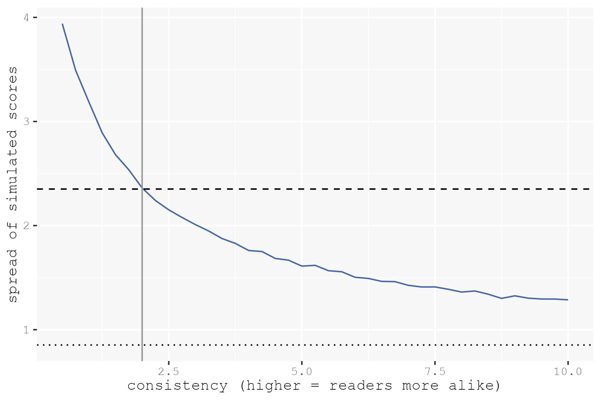
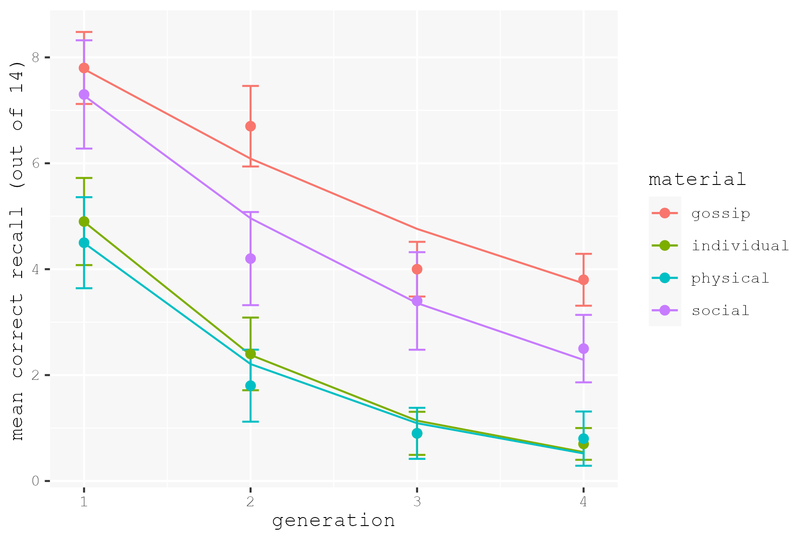
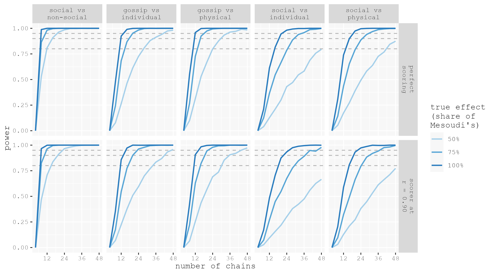

<!-- Replication reports should all use this template to standardize reporting across projects.  These reports will be public supplementary materials that accompany the summary report(s) of the aggregate results. -->

## Introduction

[Mesoudi, Whiten, and Dunbar (2006)](https://doi.org/10.1348/000712605X85871) asked whether some kinds of information survive transmission better than others. They used the transmission chain method, in which one participant’s recall becomes the subsequent participant’s stimulus, so that information fidelity and loss can be tracked as it travels. In Experiment 2, the first participant in a four-person chain read four short paragraphs, wrote down what they remembered, and then that written recall was given to the next participant in the chain. The four paragraphs matched in structure and were close in length, each containing 14 propositions across 5 sentences and written as a chain of events linked causally and temporally so that no paragraph was more coherent than another. However, the content type of these paragraphs differed: gossip about third-party social relationships, ordinary non-gossip social interactions, individual behavior, and physical events. Paragraph order was counterbalanced. Every generation of the chain’s recall was scored against the original paragraph, using [Kintsch (1974)](https://doi.org/10.4324/9781315794563) propositional analysis. The target finding for this replication is the effect of content type on how much survived, F(3, 24\) \= 12.99 for the number of original propositions recalled correctly. Gossip and non-gossip social information survived transmission better than individual behavior or physical events, and the contrast between gossip and non-gossip social information was null at F(1, 9\) \= 2.40, which the authors interpreted as being due to the presence of people interacting with each other rather than the scandalous nature of the gossip content. 

My current research asks how descriptions of people change as they pass between people, analyzing the compression and content convergence of social information across generations of transmission. I chose to replicate Mesoudi et al.’s experiment because it is more or less a rudimentary version of the study I am about to run. Their version includes chains of four participants, written recall from one participant to the next, each chain treated as an independent unit of analysis. However, while Mesoudi et al. are interested in how differing content in general survives transmission, I am interested in how differing *social* content (relationships, traits, actions, locations) about a single person survives transmission when presented all at once in one recall. Their four paragraphs were designed to vary widely from non-social to social in content, so what this replication will validate is a multi-generational chain as a sensitive enough instrument to detect content effects at all. If it is unable to separate narratives that differ this greatly, it will likely also not be able to separate smaller differences in social content such as relationships and traits.

I plan to replicate Experiment 2 by running online participants from UCSD’s undergraduate participant pool (SONA). The experimental task will be run through a web application I am building for my own chain study, which presents a previous generation’s text and collects the next generation’s written recall. The first participant in each chain will read the four paragraphs from the original study once, in a counterbalanced order, and each later participant will read the recall of the person before them. Then, they will write down what they remember, not constrained by time limit and without being presented with a distractor task. Participants will not be told that this is a recall test, that the text came from another participant prior to them, or that their recall will be passed on. Transmission will be mediated through the web application, which passes a recall to the next participant once it clears exclusion checks set in advance and holds borderline recalls for my review, ensuring an equal number of participants per chain and asynchronous participation.

There will be four primary challenges. First, the original study ran in person on printed paper, where rereading the page was prevented by physically turning the page. My web application will hide the text before the recall box appears to combat this. Online participants may also be less attentive or use outside sources to either offload information or generate responses. To address this I intend to include a minimum reading time, attention checks, and screening for responses that appear to have been assisted by AI. Second, the original scored recalls by hand, which is not feasible to reproduce at scale. Instead, I plan to score each recall with two LLMs at temperature 0 that check whether each of the 14 propositions per paragraph, as published with the original data, is present, which [Martinez (2024)](https://doi.org/10.3758/s13428-024-02480-7) found to reach an r of 0.86 to 0.94 against manual scoring of story recall. I also will hand code a subset using Kintsch (1974) propositional analysis, so that a failure to reproduce the effect is distinguishable from a failure due to the scoring. Third, an automated scorer could make different errors for different content, for example by crediting a loosely summarized social paragraph more readily than a physical one, so a content effect could potentially come from the scorer rather than from transmission. To this end I will check on the hand-coded subset that the gap between automated and human scores is the same across the four paragraphs. Finally, the effect I am focusing on is smaller than Experiment 1’s, the within-social contrast is null, and no power analysis is reported in the original paper, so I will determine the number of chains from a simulation rather than copying the original’s 10\.

From this project, I am hoping to reach four learning goals. First, I have never used SONA to recruit participants. I am only familiar with Prolific, so this is a good way to test the waters with SONA and validate it as a reliable subject pool for future research, especially as Prolific expenses are increasing. Second, I will be able to validate automated recall scoring against hand coded data. So far, I have built a tool that extracts person mentions from unnamed relational data in my own paradigm, but I have not yet validated nor expanded this tool in terms of scoring whole recalls. Third, I would like to explore power simulation for designs where the chain rather than the participant is the independent unit. This is the same question as how many chains my own study will need. Fourth, more broadly, I aim to gain more familiarity with reading and running repeated-measures designs of this kind.

I would wager this project as an entirely feasible build for the quarter. The stimuli are published, the experimental task is asynchronous and mediated by the web application, so I never need concurrent participants. I already have a good starting point on a web app that presents a generation’s text and collects the next generation. Additionally, the original study had 10 chains of four participants, which is entirely doable in a week or two, and the power analysis expands this to 12 chains, with room for up to 32. 

Response to feedback. I have changed projects since the original proposal, from Panela et al. (2025) on LLM event segmentation to Mesoudi, Whiten, and Dunbar (2006). The original proposal was built around validating an automated chunking method, but following a meeting with my advisor, that research goal was deferred. I instead would find it most pertinent and beneficial to run a diffusion chain paradigm, which is what the study I am about to run uses. Four of the five feedback points from the earlier proposal carry over, so I will address them here in light of my new proposal instead of dropping them.

Regarding examining how the measure works, the carryover to my current replication is that an automated score may behave differently across the four paragraphs, completely unrelated to transmission (outlined as the third challenge in the challenges section above). Mesoudi has since published the data and materials for this paper, including the chain-level recall scores and the Study 2 paragraphs broken into the 14 propositions each was coded on, which I will use as the coding sheet. I will email Mesoudi to ask about the counterbalancing scheme and whether the original recall texts survive.

Regarding keeping at least one original component so that failure of methods can be distinguished from failure of effect, I am hand coding a subset of recalls using Kintsch (1974) propositional analysis rather than entirely replacing the original with automated scoring.

Regarding planning exclusion criteria up front, since online participants behave differently than in person ones, I am including minimum reading time, attention checks, and screening for AI assisted responses (outlined as the first challenge in the challenges section above).

Regarding adding an exploratory section tied to my own research, specifically adding a fifth narrative that is drawn from a spoken recall, I would rather keep that separate. Adding a fifth narrative to the experiment changes how much there is to remember, so the design would no longer be a replication of Experiment 2\. Additionally, a written recall of a spoken excerpt scored against its source is not really relevant to any comparisons my own study makes, since my study exclusively uses spoken recall and measures convergence between generations in addition to fidelity to the original. I will run that comparison there instead, where it fits the design more neatly.

::: {.callout-note}
## Links
Repository: [https://github.com/kyaneos/mesoudi2006](https://github.com/kyaneos/mesoudi2006)  
Original paper: [2006_mesoudi_social_information_bias.pdf](https://github.com/kyaneos/mesoudi2006/blob/main/original_paper/2006_mesoudi_social_information_bias.pdf) (Retrieved on Oct 12, 2026 from [doi.org/10.1348/000712605X85871](https://doi.org/10.1348/000712605X85871))
:::


## Methods

### Power Analysis

#### One row of data

Each row of my data will be one participant's recall of one paragraph. It records the chain, the participant's generation, which material the paragraph was, the paragraph's position in the chain's original reading order (1 to 4), and the score. The score is the number of the paragraph's 14 original propositions the participant recalled correctly, scored against the original (F0) paragraph at every generation, as in Mesoudi et al. (2006). Each participant contributes four rows, so the 12 preregistered chains of four generations will produce 192 rows.

| chain | generation | material | position | score |
|-------|------------|----------|----------|-------|
| 3     | 2          | social   | 3        | 9     |

#### How the simulated data is made

The simulation generates data the way a chain produces it. The first participant in a chain reads the original paragraphs, so each of a paragraph's 14 propositions has one chance to be recalled, at that material's starting rate. Because some chains start with a stronger reader than others, each chain also gets a random offset to its starting rates. Every later participant can only recall what the person before them passed on. Each correct proposition they receive has one chance to survive, at that reader's own keep rate. Social materials have higher starting and keep rates than non-social materials, and this difference is the effect. Because each generation is built from the one before it, a chain that starts strong stays strong. This is why the chain is the unit of analysis.

The starting and keep rates come from the raw data for Experiment 2, which Mesoudi has since published ([github.com/amesoudi/mesoudi_whiten_dunbar_2006](https://github.com/amesoudi/mesoudi_whiten_dunbar_2006)). His `correct_recall` column is the same measure as my `score`, so I rename it.

All of the code in this section lives in one script, `power/power_sim.R`. The quick steps run live in this report. The slower ones, which are the two calibrations, the generator check, and the power loop, ran once in the script, and this report shows their code and loads what they saved.

```{r read-script}
#| include: false
knitr::read_chunk("power/power_sim.R")

```

```{r setup}
#| message: false
```

The starting rate is a material's average generation-1 score divided by 14. The keep rate is the share of correct propositions that generation 2–4 participants passed on, out of all the correct propositions they received. To compute it, each row needs the score of the person before them in the same chain (`previous`).

```{r rates}
```

Because chains differ in how strong their first reader is, each chain gets an offset. This is how far the chain's generation-1 participant scored above or below each material's average, averaged over the four paragraphs. The SD of these offsets is how much chains differ.

```{r chain-offset}
```

The SD of the offsets is `r round(chain_sd, 2)`, or about `r round(chain_sd * 14, 1)` propositions per paragraph. This means a chain's first reader typically lands one or two propositions above or below average.

Participants in generations 2–4 also differ, since some skim and some read carefully. I model these differences per paragraph, which errs toward needing more chains. Because a careful reader tends to be careful on all four paragraphs, that shared carefulness cancels out in the social minus non-social difference, so leaving it out makes the simulated differences noisier than the real ones.

Each reader's keep rate for a paragraph is drawn from a range centered on the material's keep rate. The `consistency` parameter sets how tight that range is, so high consistency means readers keep about the same share, and low consistency means they differ a lot. To choose it, I simulated a reader for each of Mesoudi's 120 real handoffs at a range of consistency values, and kept the value whose simulated scores vary as much as the real ones.

```{r consistency-calibration}
#| eval: false
```

```{r consistency-calibration-results}
# saved by power/power_sim.R
results <- readRDS("power/results.rds")
consistency <- results$consistency

```

In the plot, the blue line is how much the simulated scores vary at each consistency value, the dashed line is how much the real scores vary, the dotted line is how much they would vary from chance alone, and the gray vertical line marks the chosen value. A consistency of `r consistency` is quite spread out. This means readers differ a lot in how much of a paragraph they hold onto.

The `make_study()` function builds one simulated study with any number of chains. Its `effect` argument sets the size of the material effect. At 1, the rates are Mesoudi's. At 0.5, every material's starting and keep rates are pulled halfway toward the average of the four materials, and at 0 all four materials are identical. The noise stays the same at every setting, so only the gap between materials changes.

Reading order follows a Williams square, which is a set of four orders in which each material appears once in each position and directly follows every other material once. Order only applies at generation 1, because later generations read the previous recall as a single text. Each chain gets one order, chains rotate through the four, and every row of a chain records its paragraph's generation-1 position. Order has no effect on scores in the simulation. It is there so the simulated data has the same shape as the real data.

The `scorer_error` argument adds a simulated scorer. A participant's true recall (`true_score`) is what the next participant receives. The scorer then marks each of the 14 propositions as present or absent, and gets each one wrong with probability `scorer_error`, in either direction. The analysis only sees the recorded `score`, which matches the true score when `scorer_error` is 0.

```{r generator}
```

To check that the generator is believable, I averaged 500 simulated 10-chain studies at Mesoudi's effect and compared them with his real means. Additionally, I checked that the `effect` setting works, since the average social minus non-social difference should shrink to 75%, 50%, and 0% of the full effect.

```{r simulated-vs-real}
#| eval: false
```

```{r simulated-vs-real-results}

knitr::kable(results$effect_dial, digits = 2,
             col.names = c("effect setting", "social minus non-social"))
```

In the plot, each line is the average of 500 simulated studies, and each dot is Mesoudi's mean for one material and generation, with error bars of 1 SE across his 10 chains. Because each dot comes from a single 10-chain study, the lines and dots should not coincide. The simulated means track the real ones within about 0.8 propositions, with the largest gaps at generations 2 and 3. The simulated chains decay at a steady rate, and the real chains are bumpier, since gossip holds up at generation 2 and social drops early. This is at least partly the noise of a single 10-chain sample.

My scoring plan only accepts an automated scorer if its paragraph totals correlate with my hand coding at r $\geq$ 0.90. I set `scorer_error` so that simulated scores correlate with true scores at exactly 0.90, the weakest scorer that would still pass. Because any scorer I actually use will be at least that good, the power from this simulation is a floor. The simulated scorer's errors run both ways at random. A scorer biased in one direction, such as one that over-credits social paragraphs, is not modeled, because the validation already checks that the gap between scorer and human is the same across the four materials.

```{r scorer-error}
#| eval: false
```

```{r scorer-error-results}
scorer_error <- results$scorer_error
```

The error rate comes out at `r round(scorer_error, 3)`. This means the simulated scorer gets about `r round(100 * scorer_error)`% of its calls wrong. Because the errors run both ways, a nearly empty paragraph gets credited with one or two propositions it does not contain. This pulls scores toward the middle and shrinks the effect.

#### The planned test

Because the chain is the unit, the test sees one number per chain. This number is the chain's average score on the social materials (gossip and social) minus its average score on the non-social materials (individual and physical), across all four generations. Every score is already measured against the original paragraph, so a positive difference means more of the original social material survived the chain. This matches Mesoudi's material effect, which is also averaged over generations.

```{r chain-difference}
```

The test is a sign-flip permutation test. If social and non-social information are transmitted equally well, each chain's difference is just noise, and its sign is a coin flip. Flipping each chain's sign at random 5,000 times shows what the mean difference looks like when there is no effect. The p-value is the share of flipped means at least as far from zero as the real mean.

```{r sign-flip}
```

Mesoudi's per-chain differences range from `r round(min(real_differences), 2)` to `r round(max(real_differences), 2)` propositions, so all 10 of his chains are positive. Only 2 of the 2^10^ = 1,024 possible sign patterns are that extreme (all positive or all negative), so the exact p is 2/1,024 $\approx$ 0.002, and the 5,000 random flips estimate it at `r round(real_p, 3)`. The same logic sets a floor on sample size. With 5 chains there are only 32 sign patterns, so the smallest possible p is 2/32 = 0.0625. This means 5 chains can never reach p < 0.05.

Because Mesoudi's effect comes from only 10 chains, it is a single draw, and the true effect could be smaller. To see how much smaller is plausible, I bootstrapped his 10 per-chain differences, resampling them with replacement 10,000 times and taking the mean each time.

```{r bootstrap-effect}
```

The 95% interval runs from `r round(boot_ci[1], 2)` to `r round(boot_ci[2], 2)` propositions, around his observed `r round(mean(real_differences), 2)`. Its low end is about `r round(100 * boot_low_share)`% of his effect. This is why I plan around 75% of his effect, with 50% as a more pessimistic case. With only 10 chains, the interval itself is rough.

#### Power

Power is the chance that a study detects an effect that is really there. I simulated 1,000 studies for every combination of number of chains, true effect, and scorer, and ran the tests on each. The number of chains ranges from 4 to 48 in multiples of 4, so the reading orders balance. The true effect is 100%, 75%, or 50% of Mesoudi's, and the scorer is either perfect or the weakest acceptable at r = 0.90. Power is the share of studies that came out significant, at p < 0.05 for the planned test and at p < 0.01 for the four pairwise comparisons, which is Mesoudi's Bonferroni-corrected level. The gossip versus social comparison is left out, because the original found no difference to power for.

```{r power-sims}
#| eval: false
```

```{r power-curve}
#| eval: false
```

```{r power-curve-results}

```

Each panel is one test, and the first panel is the planned test. The top row assumes perfect scoring and the bottom row the scorer at r = 0.90. Each line is one true effect size, with darker lines for bigger effects, and the dashed lines mark 80%, 90%, and 95% power.

The table below gives the smallest number of chains that reaches each power target.

```{r chains-needed}
#| eval: false
```

```{r chains-needed-results}
knitr::kable(results$chains_table, digits = 2)

# planned test at 12 chains, 75% of the effect, weakest acceptable scorer
power_at_12 <- results$power |>
  filter(test == "planned", scorer == "scorer at r = 0.90", effect == 0.75, n_chains == 12) |>
  pull(power)
```

For the planned test, 12 chains gives `r round(power_at_12, 2)` power at 75% of Mesoudi's effect, even with the weakest acceptable scorer. This is the sample I will preregister. The four pairwise comparisons need many more chains, up to 32 for 80% power under the same conditions. Because they are secondary, any pair that is not significant at 12 chains will be reported as underpowered.

### Planned Sample

I will recruit UCSD undergraduates through the SONA participant pool. The only screening criterion is native or fluent English. Based on the power simulation, I will preregister 12 chains (48 participants). This gives `r round(power_at_12, 2)` power for the social versus non-social contrast at 75% of the original effect, even if the automated scorer agrees with human coding at only r = 0.90. Chains will continue to open as participants sign up until November 20, up to a cap of 32 chains (128 participants), the point at which the four pairwise comparisons also reach 80% power, and collection will end on November 24. Because I will not look at the results during collection, the date alone determines the final sample. If fewer than 12 chains are complete by November 24, I will analyze the chains that are complete and use the same simulation to report the power that number gives.

### Materials

The materials are the four paragraphs reproduced in Appendix B of Mesoudi et al. (2006), which I will use verbatim. Each paragraph was "designed to constitute a comparable linear chain of events linked causally and temporally." This was meant to keep any one paragraph from being easier to remember simply because it told a more coherent story. The gossip paragraph, for example, reads: "Nancy is having an affair with her married college professor. Nancy recently became pregnant with the professor's child. The professor promised Nancy that he would leave his wife, but since Nancy told him she was pregnant, the professor refused to see her. So Nancy told the professor's wife about the affair. The professor's wife was so upset that she left the professor." As in the original, "the bracketed labels, indicating the type of material and the numbers of words, sentences and propositions, were not presented to the participants." The original states that order "was now counterbalanced," but does not say how. I will therefore rotate chains through four orders from a balanced Latin square, in which each paragraph appears once in each position and follows every other paragraph once. Mesoudi also published a propositional breakdown of the four paragraphs alongside his data, which divides each paragraph into its 14 propositions. This breakdown will serve as the coding sheet for scoring.

### Procedure

Because the design of Experiment 2 was "largely identical to that of Experiment 1," I will follow the procedure described for Experiment 1: "A booklet was produced that contained on the first page the instruction, 'please read the following text through once. When you have finished turn the page', followed by the material. The second page contained the instruction, 'now, without turning back, please write out as best you can the text you just read. Be as accurate as possible, but don't worry if you can't remember it all. When you have finished turn the page', followed by a blank space for recall. A final sheet solicited the age and gender of the participant, and thanked them for participating, whereupon the experimenter debriefed them as to the nature of the study." As in the original, "no distractor task was performed, and no time limit was set. At no point in the procedure did either the printed instructions or the experimenter state that the experiment was a memory test, that the material had come from another participant, or that their recall would be passed on to another participant."

In my version, the booklet will be a web application I built, which shows each page as its own screen, keeps the original instructions word for word, collects each recall, and passes it to the next participant in the chain. Before the task, participants will answer a screening question on English fluency and an instructions check that repeats until they pass it. The text screen will then hold them for a minimum reading time, set at 400 words per minute for the length of their text. This is faster than a typical reading pace, so the minimum stops skimming without holding up a normal reader. The text cannot be selected or copied. Because participants cannot physically turn the page back, the text will disappear before the recall screen appears. On the recall screen, pasting will be blocked, and the application will log how each recall was typed and whether the participant left the page. Both screens will also carry instructions that participants cannot see, which direct an AI to include an unusual calculation in its response, so that AI-assisted recalls can be flagged. After recalling, participants will answer an honesty item about outside help and an instructed-response item alongside the age and gender questions. They will then read the debrief and return to SONA for credit. In the original, the experimenter typed each recall into the next participant's booklet. My application will pass each recall on only once it clears the exclusion checks in the Analysis Plan, automatically correcting its spelling and spacing and nothing else. Participants will receive credit whether or not their recall is excluded.

### Analysis Plan

I will keep the original's two analysis rules. First, "each chain is treated as an independent unit of analysis, rather than each participant," because "the recalls of each participant within a single chain are not statistically independent of one another." Second, "recall in each generation was always compared with the original (F0) material, not the previous generation's recall." This means every recall will be scored as the number of a paragraph's 14 original propositions it contains, giving four scores per participant and sixteen per chain.

The confirmatory test is the social versus non-social contrast. For each chain, I will average its scores on the gossip and social paragraphs across all four generations, do the same for the individual and physical paragraphs, and take the difference. I will then run a two-sided sign-flip permutation test on these per-chain differences, with 5,000 flips at $\alpha$ = 0.05. If social and non-social information are transmitted equally well, the sign of each chain's difference is a coin flip. The test asks how often random signs produce a mean difference at least as far from zero as the one observed.

Additionally, I will report three secondary analyses: 1) the original 4 (material) x 4 (generation) repeated-measures ANOVA, without gender and with Greenhouse-Geisser correction, 2) Mesoudi's own multilevel reanalysis, published with his data, and 3) the original's four social versus non-social pairwise comparisons, at the original's Bonferroni-corrected $\alpha$ = 0.01. Without gender, the ANOVA's material effect becomes F(3, 27), and on Mesoudi's data it gives 11.81 against the published F(3, 24) = 12.99, which included gender. The gossip versus social comparison will be reported descriptively, because a non-significant difference in this sample would not by itself replicate the original null.

Recalls will be scored by two LLMs at temperature 0, one proprietary model pinned to a dated version and one local model. Each will check whether each of a paragraph's 14 propositions is present. Because a scoring prompt can be adjusted until it gives a desired answer, the prompt will be developed on pilot chains only, then frozen along with both model versions before any main data are scored. Whichever model agrees better with my hand coding on the pilot chains will be the primary scorer, and the other will serve as a sensitivity check. I will hand code about a third of the chains using Mesoudi's propositional breakdown. Because I know the hypothesis, I will code these recalls in shuffled order with the chain and generation hidden. The material cannot be hidden, since the text itself gives it away. Automated scoring will pass only if three conditions hold. First, each model's paragraph totals must agree with mine at an ICC lower 95% bound of at least 0.75 and a Pearson r of at least 0.90, against the original's human agreement of r = 0.97. Second, the gap between automated and human scores must not differ across the four materials. Third, the social versus non-social effect must have the same direction and a similar size under human and automated scores. I will also report agreement between the two models, as well as Cohen's kappa for single propositions. If any condition fails, or if the two models disagree on the confirmatory result, I will hand code every recall. All human and model scores will be released with the analysis code.

Exclusions will target only recalls that do not reflect the task. A poor recall is still a result, and excluding it would inflate how much appears to survive. Clear failures will be excluded, and that generation of the chain will be rerun with a new participant. These are recalls that are empty or nearly empty, nonsensical or off-topic, contain the calculation requested by the hidden instructions, come from a participant who reports outside help on the honesty item, or were inserted rather than typed according to the typing log. The rules that need a cutoff will have fixed thresholds, set from the pilot data before collection begins. As a starting point, a recall under 10 words is nearly empty, a recall that shares no content words with the text it was given is off-topic, and a recall with fewer keystrokes than characters was inserted rather than typed. Borderline cases, in which the participant left the page or failed the instructed-response item, will hold the chain until I review them.

### Differences from Original Study

The original sample was 40 students who "participated voluntarily, were unpaid and had normal reading and writing ability," run in person "in groups of between one and five." My sample will be UCSD undergraduates from SONA, participating alone and online for course credit. The number of chains will be set by the power simulation and rounded to a multiple of four, so that the counterbalanced orders balance. The original also balanced chains by gender, with five female and five male chains. I will collect gender but will not balance or model it. Neither experiment found a gender effect (Exp 2: F(1, 8) = 0.08), and single-gender chains would be slow to fill on SONA, so this difference should not affect the result.

The task itself moves from a paper booklet to a web application. In the booklet, rereading, copying, and outside help were ruled out physically. The added measures, including the minimum reading time, non-selectable text, paste blocking, typing logs, hidden AI instructions, and the honesty and instructed-response items, exist to rule out the same things online. Excluded generations will be rerun, which the original never needed. Recalls will also be passed on with spelling and spacing corrected automatically, which is the closest online equivalent to the original experimenter typing them up. The original does not say how order was counterbalanced, so the balanced Latin square is my own choice.

The largest analytic difference is scoring. The original hand coded every recall using Kintsch (1974) propositional analysis, and I will score with LLMs validated against my hand coding of a subset. My confirmatory test also differs. I will use a permutation test on the social versus non-social contrast, and the original used a mixed ANOVA with planned comparisons. However, I will report the original analysis alongside it.

Two of these differences could matter. Online participants may be less attentive, which would lower recall overall. Because every chain contributes both social and non-social scores, lower overall recall should lower both scores together and leave the difference intact, unless attention affects the materials unevenly. Automated scoring also adds error, which would weaken the effect. This is why the power simulation includes scoring error at the weakest scorer the validation would accept.

### Methods Addendum (Post Data Collection)

You can comment this section out prior to final report with data collection.

#### Actual Sample
  Sample size, demographics, data exclusions based on rules spelled out in analysis plan

#### Differences from pre-data collection methods plan
  Any differences from what was described as the original plan, or “none”.


## Results


### Data preparation

Each recall will be stored exactly as typed. The version passed to the next participant, with only spelling and spacing corrected, will be stored separately, and all scoring will use the original. Recalls that failed a clear exclusion check at submission will already have been removed and their generation rerun, so the analyzed data will contain only accepted recalls. Additionally, I will report how many recalls were excluded under each rule, and borderline recalls that I reviewed and accepted will stay in. Chains that have not completed all four generations by the end of collection will be dropped. Each remaining recall will then be scored against the 56 propositions of the four original paragraphs, 14 per paragraph, with each proposition marked present or absent. This gives four scores per participant, one for each paragraph. Before scoring, I will randomly choose about a third of the chains to hand code for the validation checks in the Analysis Plan. The final data will have one row per participant per paragraph, which records the chain, the generation, the material, the paragraph's position in the chain's original reading order, and the number of its propositions recalled correctly. For the confirmatory test, each chain then becomes a single number: its average score on the gossip and social paragraphs minus its average score on the individual and physical paragraphs, across all four generations.
	
```{r include=F}
### Data Preparation

#### Load Relevant Libraries and Functions

#### Import data

#### Data exclusion / filtering

#### Prepare data for analysis - create columns etc.
```

### Confirmatory analysis

Mesoudi et al. (2006) conclude that "human cultural transmission is biased toward information concerning social interactions over equivalent non-social information." This is the main inference of the paper. The original tested it in two steps. First, an overall ANOVA asked whether the four materials differed at all in how much of them survived, F(3, 24) = 12.99. This test does not say which materials did better, so it would have been just as significant if the physical paragraph had survived best. Second, four pairwise comparisons, each pairing a social paragraph with a non-social one, showed the direction of the difference. Neither step alone tests the claim.

I will test the claim in one step. For each chain, I will take its average score on the two social paragraphs minus its average score on the two non-social paragraphs, across all four generations, the same way the original's effect of material was averaged. A positive number means more of the social information survived in that chain. I will then run a two-sided sign-flip permutation test on these numbers, with 5,000 flips at $\alpha$ = 0.05. If social and non-social information survive equally well, each chain's number is just as likely to be negative as positive. Flipping the signs at random 5,000 times shows how large the average gets by chance alone, and the p-value is the share of flips that produce an average at least as far from zero as the real one. This makes no assumption about the shape of the data, which 12 chains are too few to check. Because it is a single comparison of two things, social and non-social, it needs no sphericity correction and no correction for multiple comparisons. The original's $\alpha$ of 0.01 was the 0.05 split across five comparisons.

If the average difference is positive and the test is significant, the effect replicates. Additionally, I will report the original ANOVA and pairwise comparisons alongside it, so my results can be compared directly with the original's. I will also plot correct recall by generation and material next to the original's Figure 4.

#### Confirmatory test on simulated data

Until the data are collected, this section runs the confirmatory test on one simulated study. The study uses the planned condition from the power analysis, which is 12 chains at 75% of Mesoudi's effect, scored by a scorer that agrees with true scores at only r = 0.90. Because the effect is built into the generator, the estimate should land near the built-in difference, which I find by averaging 1,000 simulated studies at the same condition. The seed is fixed, and the draw is reported as is. Once the real data are in, they will replace `study`, and the code below will run unchanged.

```{r confirmatory-sim}
# the built-in difference: the average over 1,000 simulated studies
built_in <- mean(map_dbl(1:1000, \(i) {
  mean(chain_difference(make_study(12, effect = 0.75, scorer_error = scorer_error))$difference)
}))

# one simulated study at the planned condition
set.seed(2006)
study <- make_study(n_chains = 12, effect = 0.75, scorer_error = scorer_error)
study_differences <- chain_difference(study)$difference
study_p <- sign_flip_p(study_differences)

tibble(chains = 12,
       estimate = mean(study_differences),
       built_in = built_in,
       chains_positive = sum(study_differences > 0)) |>
  knitr::kable(digits = 2)
```

The estimate is `r round(mean(study_differences), 2)` propositions against a built-in `r round(built_in, 2)`, and the test gives p = `r round(study_p, 3)`. This is one study. The power curve in the Power Analysis shows how often a study like this one succeeds as the number of chains and the size of the effect change.

### Exploratory analyses

Any follow-up analyses desired (not required).  

## Discussion

### Summary of Replication Attempt

Open the discussion section with a paragraph summarizing the primary result from the confirmatory analysis and the assessment of whether it replicated, partially replicated, or failed to replicate the original result.  

### Commentary

Add open-ended commentary (if any) reflecting (a) insights from follow-up exploratory analysis, (b) assessment of the meaning of the replication (or not) - e.g., for a failure to replicate, are the differences between original and present study ones that definitely, plausibly, or are unlikely to have been moderators of the result, and (c) discussion of any objections or challenges raised by the current and original authors about the replication attempt.  None of these need to be long.
